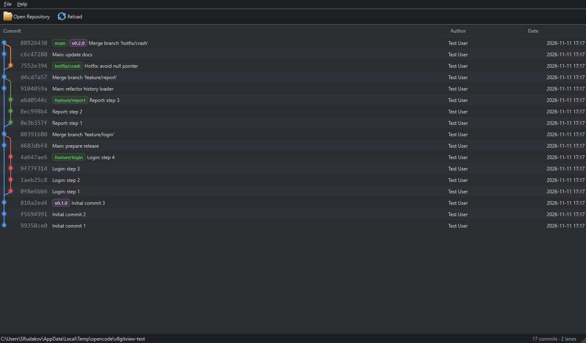

# v8GitView

Быстрый просмотрщик истории Git для больших репозиториев, в первую очередь
1С:Предприятие. Написан на C++20 с Qt 6 Widgets и libgit2, распространяется
под лицензией MIT.



## Возможности

- Граф коммитов с цветными lane'ами, merge-ветками и точками коммитов.
- Ленивая подгрузка истории: первые 1 000 коммитов, далее — порциями по 1 000
  при прокрутке. При старте не читается вся история огромного репозитория.
- Отрисовка только видимых строк: `QAbstractTableModel` +
  `QStyledItemDelegate`, без виджета на каждый коммит.
- Фоновая загрузка в отдельном потоке; интерфейс не блокируется.
- Бейджи локальных веток, удалённых веток и тегов, сокращённый SHA, автор и
  дата, тёмная тема.
- Открытие репозитория из GUI, перетаскиванием пути в командной строке или
  параметром `v8GitView.exe <путь>`.
- Не требует прав администратора: portable-сборка MSYS2.

## Чего пока нет

Это ранний каркас (0.1.0), а не полноценная замена SourceTree:

- нет diff, blame, истории файла и операций с индексом;
- нет checkout/commit/merge/push/pull;
- нет поиска и фильтров по автору, дате и сообщению;
- нет чтения Bloom-фильтров commit-graph для истории файла.

Планы развития перечислены в [docs/architecture.md](docs/architecture.md).

## Сборка под Windows (MSYS2 mingw64)

Требования:

- Windows 10/11 x64;
- MSYS2 с toolchain mingw64;
- Qt 6.5+ (проверено на Qt 6.11.2);
- libgit2 1.9.x (проверено на 1.9.7);
- CMake 3.24+ и Ninja.

Установка пакетов в MSYS2:

```bat
pacman -S --needed mingw-w64-x86_64-gcc ^
    mingw-w64-x86_64-qt6-base ^
    mingw-w64-x86_64-libgit2 ^
    mingw-w64-x86_64-cmake ^
    mingw-w64-x86_64-ninja
```

Сборка:

```bat
set MSYS2_ROOT=C:\msys64
set PATH=%MSYS2_ROOT%\mingw64\bin;%PATH%
scripts\build_mingw64.bat %MSYS2_ROOT% release
```

Если CMake и Ninja установлены отдельно, добавьте их каталоги в `PATH`.
Скрипт принимает путь к MSYS2 первым аргументом и конфигурацию вторым
(`debug` или `release`).

Запуск:

```bat
scripts\run_mingw64.bat C:\path\to\repository %MSYS2_ROOT% release
```

Или напрямую:

```bat
build\mingw64-release\v8GitView.exe C:\path\to\repository
```

Для запуска напрямую в `PATH` должен быть каталог `%MSYS2_ROOT%\mingw64\bin`,
иначе не найдутся `Qt6Widgets.dll` и `libgit2.dll`.

## Производительность на больших репозиториях 1С

1. Для каждого крупного репозитория один раз выполните:

   ```bat
   git commit-graph write --reachable --changed-paths
   ```

   Это ускоряет обход истории. Bloom-фильтры (`--changed-paths`) нужны для
   будущей истории файла.

2. Загрузка идёт батчами: 1 000 коммитов на запрос, префетч первых ~400
   строк. Память под всю историю сразу не выделяется.

3. Граф считается инкрементально по списку родителей, без парсинга
   `git log --graph` и без хранения объектов libgit2 после чтения коммита.

4. Рисуются только видимые строки. Для списка истории не читаются блобы,
   деревья и diff'ы.

5. Тяжёлые операции (история файла, rebase, LFS, GPG) в будущем планируется
   выносить в `git` CLI, а чтение истории/status/diff оставить на libgit2.

## Архитектура

Кратко:

```
libgit2 revwalk (topo + time)
        │  фоновый QThread
        ▼
HistoryLoader ──батчи──► CommitModel (QAbstractTableModel)
        │                        │
   GraphLayout              CommitView + CommitDelegate
   (lane-разметка)          (рисует только видимые строки)
```

Подробнее: [docs/architecture.md](docs/architecture.md).

## Лицензия

Код проекта — [MIT](LICENSE).

Сторонние компоненты и их лицензии перечислены в [NOTICE](NOTICE):

- Qt 6 — LGPL-3.0 / GPL-3.0 / коммерческая, динамическая линковка;
- libgit2 — GPL-2.0 с linking exception;
- идеи дизайна — lazygit, GitAhead, SourceGit (MIT), код не копировался.
